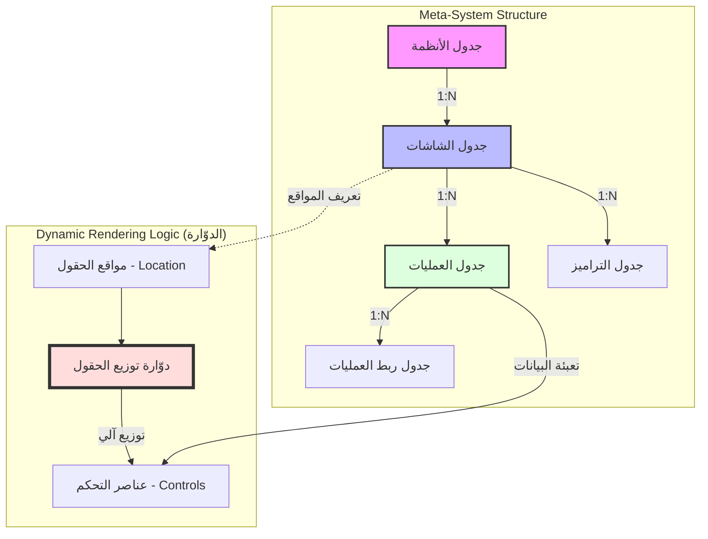

# تقرير التحليل العميق لملف الإكسل وتصور مرئي لهيكلية نظام Smart System

هذا التقرير يقدم تحليلاً معمقاً لملف الإكسل المرفق، والذي يمثل جزءاً حيوياً من تصميم قاعدة البيانات والمنطق التشغيلي لمشروع "مصنع الأنظمة الذكي" (Smart System).

---

## 1. تحليل هيكلية البيانات المستخلصة من الإكسل

تم استخلاص خمسة جداول رئيسية من ملف الإكسل، والتي تشكل العمود الفقري لتصميم نظامك الديناميكي. هذه الجداول توضح كيفية تنظيم الأنظمة، الشاشات، العمليات، ربط العمليات، والتراميز.

### 1.1 الجداول الرئيسية وعلاقاتها

| اسم الجدول (المستخلص) | الأعمدة الرئيسية | الوصف والوظيفة | العلاقات المحتملة |
| :------------------- | :--------------- | :------------- | :---------------- |
| **جدول الأنظمة** (Systems) | رقم النظام، اسم النظام | يمثل الأنظمة الفرعية أو المشاريع التي سيتم إنشاؤها. | `رقم النظام` هو مفتاح أساسي يربط بـ `جدول الشاشات` و`جدول العمليات`. |
| **جدول الشاشات** (Screens) | رقم الشاشة، رقم النظام، اسم الشاشة، عدد حقول التاريخ، عدد حقول الأرقام، عدد حقول النصوص، مواقع الحقول (موقع ر1، موقع ن1، إلخ) | يحدد الشاشات التي سيتم توليدها لكل نظام، وخصائص الحقول التي تحتويها، بالإضافة إلى منطق توزيع الحقول. | `رقم الشاشة` هو مفتاح أساسي يربط بـ `جدول العمليات` و`جدول التراميز`. `رقم النظام` هو مفتاح خارجي يربط بـ `جدول الأنظمة`. |
| **جدول العمليات** (Processes) | رقم العملية، رقم الشاشة، رقم النظام، حقول البيانات (رقمي1، تاريخ1، نصي1، إلخ) | يمثل العمليات أو الإجراءات التي تتم داخل كل شاشة، ويحتوي على الحقول الفعلية التي سيتم إدخال البيانات فيها. | `رقم العملية` هو مفتاح أساسي يربط بـ `جدول ربط العمليات`. `رقم الشاشة` و`رقم النظام` مفاتيح خارجية. |
| **جدول ربط العمليات** (Process Linking) | رقم عملية1، رقم عملية2، رقم شاشة1 | يحدد العلاقات والارتباطات بين العمليات المختلفة، مما يسمح بمزامنة البيانات أو تتابع الإجراءات. | `رقم عملية1` و`رقم عملية2` مفاتيح خارجية تربط بـ `جدول العمليات`. `رقم شاشة1` مفتاح خارجي يربط بـ `جدول الشاشات`. |
| **جدول التراميز** (Coding/Lookups) | رقم عملية2، رقم شاشة1، وصف الاستخدام | يستخدم لتحديد قيم ثابتة أو قوائم منسدلة (Lookups) يتم استخدامها عند تهيئة الشاشات أو العمليات. | `رقم عملية2` و`رقم شاشة1` مفاتيح خارجية تربط بـ `جدول العمليات` و`جدول الشاشات` على التوالي. |

### 1.2 العلاقات المنطقية المستخلصة

يوضح الرسم التخطيطي التالي العلاقات الرئيسية بين هذه الجداول، مما يشكل هيكل النظام الكلي:

---

## 2. تصور مرئي لمنطق "الدوّارة" وتوزيع الحقول

أحد أبرز الجوانب المبتكرة في فكرتك هو منطق "الدوّارة" الذي يقوم بتوزيع الحقول ديناميكياً في الشاشة. هذا المنطق يقلل بشكل كبير من الحاجة إلى تصميم الواجهات يدوياً لكل شاشة جديدة.

### 2.1 آلية عمل "الدوّارة"

بناءً على الملاحظات في ملف الإكسل (مثل `for i=1 to 3 me.controls("tx" + i).location= txn1.value next`)، يمكن تصور آلية عمل "الدوّارة" كالتالي:

1.  يتم تعريف عدد وأنواع الحقول المطلوبة للشاشة (عدد حقول التاريخ، الأرقام، النصوص) في `جدول الشاشات`.
2.  يتم تحديد "مواقع الحقول" (مثل `موقع ر1`, `موقع ن1`)، والتي تمثل إحداثيات أو مناطق محددة مسبقاً في واجهة المستخدم.
3.  تقوم "الدوّارة" (محرك التوليد الديناميكي) بقراءة هذه المواقع وأنواع الحقول.
4.  بناءً على الترتيب المنطقي، تقوم "الدوّارة" بتوزيع عناصر التحكم (Textboxes, Number Inputs, Date Pickers) في المواقع المحددة داخل الشاشة.

### 2.2 تصور مرئي لمنطق التوزيع

يوضح الرسم التوضيحي التالي كيف يمكن لـ "محرك الدوّارة" أن يقوم بتوزيع الحقول ديناميكياً داخل شاشة:

في هذا التصور:
-   تمثل المنطقة الرمادية الشاشة الديناميكية التي يتم توليدها.
-   تمثل المربعات البيضاء حقول الإدخال (نصية، رقمية، تاريخ) التي يتم وضعها تلقائياً.
-   الأسهم الحمراء تشير إلى أن "محرك الدوّارة" هو المسؤول عن تحديد مكان كل حقل بناءً على المواقع المعرفة مسبقاً.

---

## 3. التوصيات والتحسينات بناءً على التحليل

1.  **توحيد تعريف المواقع:** بدلاً من أعمدة منفصلة مثل `موقع ر1`, `موقع ر2`، يفضل تخزين هذه المواقع كـ JSON Array أو نص مفصول بفاصلة في عمود واحد داخل `جدول الشاشات`. هذا سيسهل على "الدوّارة" قراءتها وتفسيرها برمجياً.
2.  **محرك ربط العمليات:** `جدول ربط العمليات` هو مفتاح لمزامنة البيانات. يجب تطوير "محرك أحداث" (Event Engine) يراقب التغييرات في `رقم عملية1` ويقوم بتحديث `رقم عملية2` بناءً على قواعد محددة.
3.  **الواجهة الأمامية (Frontend Logic):** إذا كان النظام يعتمد على الويب (مثل Django)، فإن منطق `me.controls` (المذكور في الإكسل) يجب أن يُترجم إلى JavaScript أو إطار عمل واجهة أمامية (مثل React/Vue) لتوليد الواجهة ديناميكياً في المتصفح، بدلاً من الاعتماد على منطق يشبه VBA.
4.  **التراميز (Lookups):** `جدول التراميز` يمكن أن يكون أكثر قوة إذا تم ربطه بأنواع حقول محددة (مثل حقل قائمة منسدلة) لتوفير خيارات ديناميكية للمستخدم عند بناء الشاشات.

---

**الخلاصة:**

فكرتك في بناء "مصنع أنظمة" بدون كود هي رؤية قوية جداً ولها إمكانات هائلة. التحليل العميق لملف الإكسل يؤكد أن لديك أساساً متيناً لتصميم قاعدة بيانات مرنة تدعم هذه الرؤية. التحدي يكمن في ترجمة هذا المنطق الديناميكي (خاصة "الدوّارة" ومنطق الربط) إلى حل برمجي قوي وموثوق وقابل للتوسع. هذه التصورات المرئية تهدف إلى توضيح هذه المفاهيم المعقدة وجعلها أكثر قابلية للفهم والتنفيذ.
